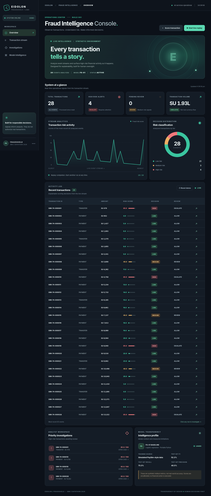

# EIDOLON // FRAUDSHIELD

**Explainable financial fraud intelligence — IBM Z Datathon 2026 proof of concept.**

> **Status: working local MVP, NOT a production fraud platform.** The included classifier is trained and measured **only on our generated synthetic examples**. Its 0–100 output is a model risk score, not a calibrated probability. PaySim (a separate synthetic dataset) integration is included for replay/evaluation, but the model is **not trained on PaySim** yet. No money is moved, no accounts are blocked, and no real customer data is required. The dashboard displays monetary values as **SU (simulation units)**, not rupees or any asserted bank currency.



## What's implemented

- Self-contained, polished responsive dashboard with risk chart, classifications and alerts
- Validated transaction scoring API; standardized, shared training and inference features
- Portable **standard-library logistic regression** baseline with chronological synthetic train/validation/test partitions
- 85-event synthetic replay worker and automatically updating dashboard
- Persistent SQLite transaction history, analyst review actions, review audit log
- Synthetic test precision/recall/F1/false-positive-rate metrics included in the model artifact
- PaySim CSV replay and streaming external-dataset evaluation utilities
- Dependency-free runtime and tests: **Python 3.10+, no Docker, no Node, no API key, no pip install**

## Quick start

### macOS / Linux / IBM LinuxONE

```bash
cd eidolon-fraudshield
python3 run.py
```

### Windows PowerShell

```powershell
cd eidolon-fraudshield
py run.py
```

Open **http://127.0.0.1:8000**. Click **Start live replay** or **Score transaction**. Open an event to inspect the reasons and record analyst disposition. Data is saved to `data/fraudshield.sqlite3`.

To run tests and retrain the included synthetic model:

```bash
python3 -m unittest discover -s tests -v
python3 scripts/train_model.py
```

Optional server port (macOS / Linux): `PORT=8080 python3 run.py`. On Windows PowerShell: `$env:PORT="8080"; py run.py`.

## PaySim dataset integration

The publicly available [PaySim dataset](https://www.kaggle.com/datasets/ealaxi/paysim1) is **itself synthetic financial data**, not actual banking records. Download it through the data provider and extract its CSV (the CSV is not bundled or auto-downloaded).

When the app is running, replay selected CSV records:

```bash
python3 scripts/replay_paysim.py /path/to/paysim.csv --limit 100 --delay 0.10 --min-step 300
```

To evaluate our *synthetic-trained* baseline on PaySim without saving data:

```bash
python3 scripts/evaluate_paysim.py /path/to/paysim.csv --min-step 600
```

**Interpretation warning:** This is an out-of-domain generalization check, not a holdout result from PaySim model training. The synthetic-trained baseline may perform poorly. The next scientific milestone is a *separate* PaySim-trained model and temporal test set.

**Leakage warning:** PaySim's dataset description states that fraud is cancelled and explicitly cautions against using origin/destination balance columns as predictive inputs. This app accepts these fields for compatibility/display but **never uses either pre- or post-transaction balances as model features**, nor `isFraud` or `isFlaggedFraud`. Fraud labels are used only for separate offline evaluation.

## System diagram

```text
Synthetic replay OR PaySim CSV event stream
                     │
                     ▼
            Input validation / API
                     │
                     ▼
             Shared feature map
                     │
                     ▼
          FS-01 risk-scoring model
                     │
            ┌────────┴─────────┐
            ▼                  ▼
     SQLite event store   Reasons + decision
            │                  │
            └────────┬─────────┘
                     ▼
         Live browser console
                     │
                     ▼
      Analyst review / audit trail
```

### REST API

| Method | Route | Purpose |
|---|---|---|
| `GET` | `/api/health` | Health / model version |
| `GET` | `/api/state` | Dashboard state, model context, replay progress |
| `GET` | `/api/events?limit=60` | Recent transactions |
| `POST` | `/api/score` | Score and store a PaySim-like event |
| `POST` | `/api/demo/start` | Start synthetic event replay, `{"count":85}` |
| `POST` | `/api/demo/reset` | Delete local demo events, `{}` |
| `POST` | `/api/review` | Analyst disposition, `{"id":1,"disposition":"INVESTIGATING"}` |

Example manual score:

```bash
curl -X POST http://127.0.0.1:8000/api/score \
  -H 'Content-Type: application/json' \
  -d '{"step":36,"type":"TRANSFER","amount":68000,"oldbalanceOrg":72000,"oldbalanceDest":4000,"transactionId":"TEST-001"}'
```

### Model caveats

- Threshold is selected on the synthetic validation partition, not test.
- Metrics from `models/baseline.json` apply **only** to our generated synthetic distribution.
- Explanations list positive logistic feature contributions, not counterfactual or causal evidence.
- No data drift monitoring, calibrated probabilities, authentication, production throughput/latency SLOs or real banking integration yet.
- For public deployment, add auth, rate limiting, transport security, CSRF protection, access controls, retention policy and audit integrity. **Never expose this development server to the open Internet.**

## Event schedule (IST)

- **Oct 16, 2026, 7:30 PM** — mandatory LinuxONE setup session
- **Oct 17, 2026, 9–10 AM** — global Datathon kickoff; final-project submission opens at 10 AM
- **Oct 18, 2026, 10 AM** — team lead's final project submission deadline

See [IBM Z deployment instructions](docs/IBM_Z_DEPLOYMENT.md) and [scientific validation roadmap](docs/VALIDATION.md).

## Roadmap

1. **Built:** functional synthetic end-to-end demonstrator with recording and analyst review.
2. **Next:** temporal PaySim dataset training, explainable tree-model benchmark, precision–recall curves, threshold/latency benchmarking.
3. **Next:** deploy and verify on actual IBM LinuxONE `s390x`, capture host diagnostics and demo evidence.
4. **Next:** final pitch, architecture, risk/limitations slides and recorded walkthrough.

Project name: **EIDOLON FRAUDSHIELD**. Challenge: **Real-Time AI for Critical Decisions**.
